# foldatron - Illustrated assembly manual

Assembly companion A1. Separate from the design guide. Prototype: physical validation and H1-H5 release required.

[Printable PDF](../Foldatron-illustrated-assembly-manual.pdf)

## Engineering release register

### H1 / yoke

FAB-M03/M04, hubs, horn, bearings: Resolve arm/hub center alignment and joint edge distances. The old 190 mm crossbar spans support centers +/-95, but hole rows at +/-6 from those centers can fall beyond its ends. The arm envelope also puts outer holes too close to an edge. Release corrected blanks, joints and vendor mounting patterns before machining.

### H2 / float

Rails, carriers, shoes and shoulder-screw stack: Release carrier connections, rail/carriage screws, travel retainers and bushing/spacer dimensions. Demonstrate +/-6 mm radial and approximately +/-2 mm tangential travel without losing retention.

### H3 / guard

Frame joints, outriggers, panels and controls: Release load-bearing supports from 500 x 400 base to wider guard, frame overlaps, panel/door hole patterns and control mounting panel. G01 has only 480 mm stock remaining before saw kerfs after its listed frame cuts; recheck extra material and fasteners.

### H4 / drive

Configured clutch and damper: Confirm EAS12 configuration and low-torque adjustment with vendor; select the actual damper and design its stationary reaction bracket and output coupling. These are not fully specified purchased kits.

### H5 / electrical

Safety circuit and permit board: Approve relay revision, series-device fault behavior, fuses/inrush, device contact IDs and optocoupler package pin map. Verify actual motor-power removal and no automatic restart.

## Fabricated parts

| FAB ID | Qty | Reference | BOM |
| --- | --- | --- | --- |
| M01 | 1 | Base 500 x 400 x 8; grid/foot holes: step 02 | BOM M01 |
| M02 | 2 | Tower 100 x 180 x 8 + 100 x 50 x 6 foot; vendor adapters | BOM M02 |
| M03 | 2 | Arm 125 x 25 x 6 envelope; H1 revised joint required | BOM M02 |
| M04 | 1 | Crossbar 190 x 25 x 6 envelope; H1 revision required | BOM M02 |
| M05 | 1 | Moving plate 100 x 135 x 4; four 4.5 x 20 slots | BOM M02 |
| M06 | 1 | Fixed plate 100 x 135 x 4; measured camera relief | BOM M02 |
| M07 | 2 | Riser 100 x 125 x 6 + 100 x 40 x 6 foot; shim height | BOM M02 |
| M08 | 8 | Acetal shoe 20 x 15 x 8; 4.5 x 10 slot; measured contour | BOM M03 |
| M09 | 1 | Shelf 100 x 100 x 6 + two 100 mm slotted angles | BOM M02 |
| M10 | 4 | Stop/switch angle 40 x 25 x 3; 4.5 x 15 base slots | BOM M02 |
| M11 | 1 | Adapter diameter 30 x 10; 6 H7 split bore; vendor horn pattern | BOM M02 |
| M12 | 2 | Guide carrier 100 x 25 x 4; rail pattern and joints H2 | BOM M02 |
| M13 | 2 | Acetal cam 20 x 15 x 3; output-side adjustable fixing | BOM M02* |
| M14 | 5 | 4 mm panels: 560 x 360 (2), 460 x 360 (2), 560 x 460 (1) | BOM G03 |

## 01. Inventory and measure the specimen

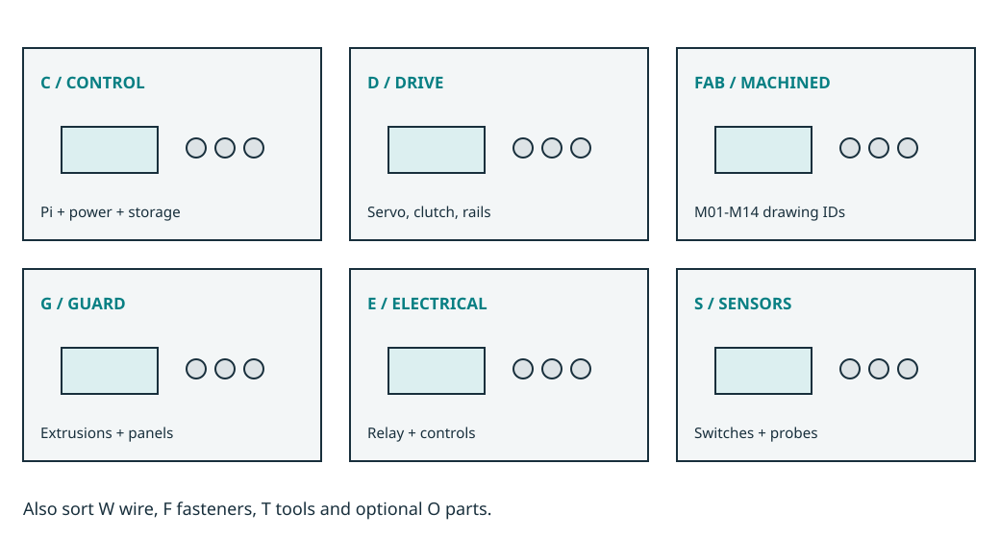

**Parts:** BOM T01 caliper/angle gauge; T05 two-leaf dummy; all 60 BOM lines; actual phone for measurements only.

**Tools:** Caliper, straightedge, camera, parts trays

1. Sort purchased parts by BOM ID. Mark fabricated pieces FAB-M01 through FAB-M14; these are drawing IDs, not the similarly numbered BOM stock items. Keep vendor screws with their component.
2. Record each phone half's width, thickness, rigid contact lands, camera projection, USB and button keep-outs. Measure actual relaxed closed/open angles. Nominal exterior dimensions are not drilling dimensions.
3. Make a two-leaf clearance dummy from those measurements. Mark stationary USB half, moving half and hinge center. A simple dummy does not reproduce the real hinge path or torque.
4. Obtain the actual bearing, horn, hub, slide and clutch drawings. Resolve the release register on page 3 before machining their interfaces.

**Check:** All parts identified; specimen measurement sheet completed; unresolved interfaces assigned to an engineer. No phone is installed during mechanical assembly.

Phone/dummy drawing rev: ______   Vendor drawing pack rev: ______

## 02. Prepare the fabricated parts

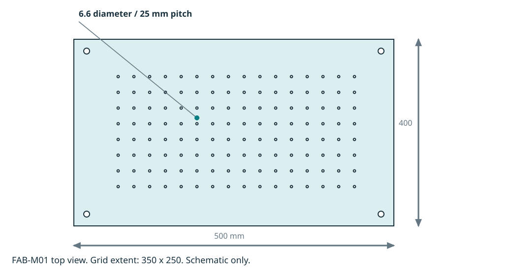

**Parts:** BOM M01 base, M02 plate-stock set, M03 shoe blanks x8; FAB-M01 to M13; F04 shims/witness paint.

**Tools:** Mill/drill, deburr tools, caliper, square

1. Machine the base 500 x 400 x 8 mm. With origin at its center, the reference grid is X=-175 to +175 and Y=-125 to +125 in 25 mm increments, holes diameter 6.6 mm. Foot centers are X=+/-230, Y=+/-180.
2. Make plate blanks to the fabrication register. Transfer mounting patterns from accepted vendor drawings; keep adjustment slots within adequate edge distances. Do not use this booklet or the envelope SVG as a drill template.
3. Hold FAB-M03/M04 yoke drilling until the joint is corrected: the old crossbar and arm envelope dimensions do not leave reliable edge distance at all fasteners. Use a released detail drawing with two M4 fasteners per outer joint.
4. Deburr; break general edges at least 0.5 mm and round phone-adjacent corners to at least R2. Clean all chips and mark each part away from contact surfaces.

**Check:** Noncritical stock dimensions within +/-0.5 mm; hole positions within +/-0.2 mm or the released tighter requirement. Bearing fits follow the bearing supplier.

Fabrication drawing rev: ______   Inspection initials: ______

## 03. Build the base and support structure

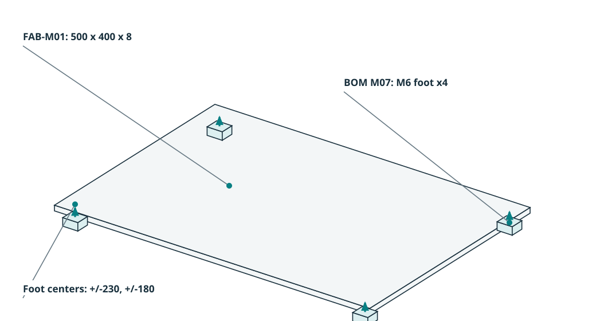

**Parts:** FAB-M01 x1; BOM M07 rubber feet x4; F03 M6 hardware; G01 guard-support material per released H3 drawing.

**Tools:** Hex keys, square, straightedge, torque tool

1. Place the base on a protected surface. Fit one M6 foot at each corner hole with a washer and locking arrangement compatible with the delivered foot. Select bolt/stud length using the fastener worksheet.
2. Turn upright and level on a rigid bench. Keep X left/right, Y along the hinge, Z upward; negative Y is the operator/front side. Mark the centerline and the two support stations at Y=-95 and +95 mm.
3. Attach the released guard outriggers or support plinth. The guard is wider and deeper than the base; do not leave it supported only by its plastic panels. Exact supports are an unresolved design interface H3.
4. Trial-place the electrical enclosure outside the swept envelope. Leave access to the E-stop, reset, power plugs, service cover and front door.

**Check:** Base is stable with no rocking. Support diagonals differ by no more than 1 mm. Guard and enclosure loads have a positive load path to the bench.

Foot fixing torque/source: ______   Base level check: ______

## 04. Align the two bearing towers

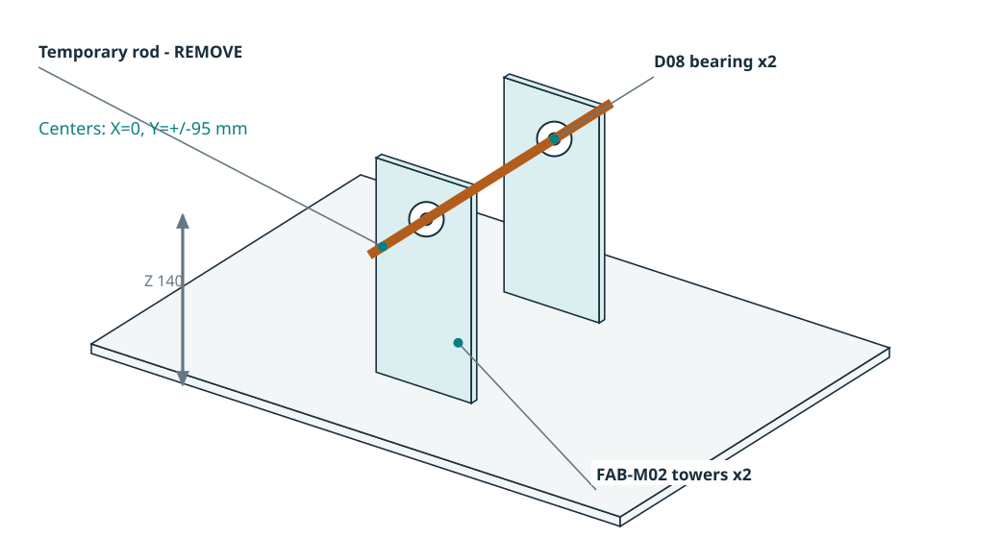

**Parts:** FAB-M02 towers x2 with angle feet/adapters; BOM D08 bearings x2; F03 M6 fixings; F04 shims; temporary 6 mm alignment rod.

**Tools:** Height gauge or caliper, indicator, hex keys

1. Bolt each tower foot loosely to the base. Place bearing centers at Y=-95 and +95 mm. Use the tower slots to bring both centers to X=0 and Z=140 mm above the base top.
2. Insert a straight temporary rod through both bearings. Adjust feet and bearing adapters until the rod slides freely without levering either tower. Measure center height and lateral alignment at both ends.
3. Tighten progressively, rechecking after each stage. Target bearing-axis mismatch no greater than 0.2 mm. Do not use tightening force to bend the alignment rod into position.
4. Remove the alignment rod and label it SETUP ONLY. It must never remain across the phone hinge space.

**Check:** Alignment remains within target after tightening; rod removed. Mounting screws do not bottom or deform bearing housings.

Front X/Z: ______   Rear X/Z: ______   Rod removed: [ ]

## 05. Install stubs and the rotating yoke

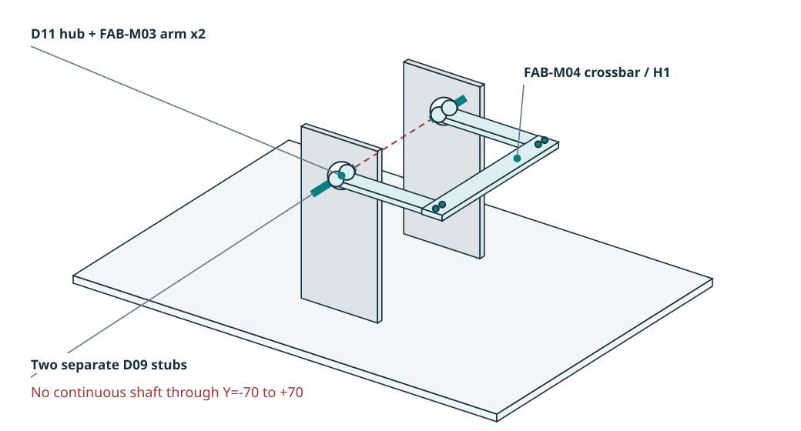

**Parts:** BOM D09 shaft stock cut to accepted stack; D10 collars x4; D11 arm hubs x2; FAB-M03 arms x2, FAB-M04 crossbar x1; four M4 outer-joint fasteners.

**Tools:** Hex keys, caliper, indicator, torque tool

1. Use two separate 6 mm stubs. The front stub projects toward the drive; the rear is an idler. Derive cut lengths from the delivered bearing, collar, hub and clutch engagements. The SCAD lengths are envelope references only.
2. Install a collar on each side of each bearing support, allowing free rotation without axial clamping of the bearing. Keep shaft ends and all drive hardware outside the phone keep-out region Y=-70 to +70 mm.
3. Fit the two split-clamp hubs and released radial arms. Join the outer crossbar at nominal X=115 mm using two M4 fasteners per joint. Close H1 before drilling; align the real hub centers with the shaft axes.
4. Rotate the empty yoke by hand through its planned arc. Recheck collar clearance, screw engagement and rigidity, then add witness marks.

**Check:** Empty hinge space; free motion without a tight spot; no axial escape. Both hub/arm joints follow a released drawing, not the old envelope model.

Stub lengths front/rear: ______   Yoke drawing rev: ______

## 06. Fit the motor and slip clutch

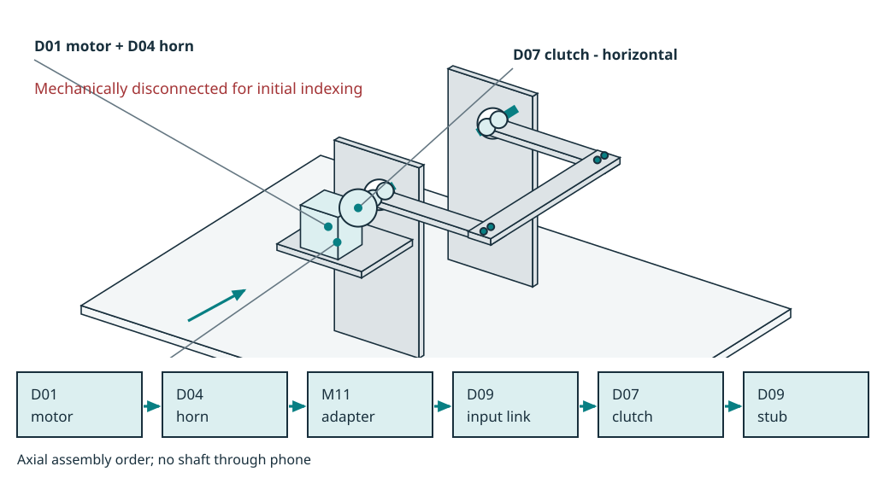

**Parts:** BOM D01 XM430-W350-T; D04 horn/bracket; D07 confirmed EAS12 clutch; D09 input link; D10 remaining collars as required; FAB-M09 shelf, FAB-M11 adapter.

**Tools:** Indicator, hex keys, low-range torque tool

1. Install the horn with the supplied ROBOTIS screws and instructions. Transfer its actual bolt pattern to FAB-M11. Verify 6 mm bore fit, clamp retention, screw depth and clearance; never invent spline dimensions.
2. Attach the motor bracket to the slotted shelf outside the front tower. Arrange the axial chain: motor/horn, adapter, short input link, clutch, front stub, supported yoke.
3. With the clutch disconnected, align the drive axis to the supported stub; target no more than 0.1 mm offset. Connect without forcing the shafts sideways. Do not use the servo output bearing as the sole fixture support.
4. Keep the clutch horizontal. The EAS12-6MM-6MM is a requested configuration: verify supplier acceptance, shaft engagement, both-direction adjustment and mounting instructions before fitting. Leave mechanically uncoupled for electrical/indexing steps.

**Check:** All clamp engagements measured and recorded. The adapter and clutch turn without binding; coupling remains open until step 23.

Clutch serial/configuration: ______   Alignment: ______ mm

## 07. Build the radial floating carriage

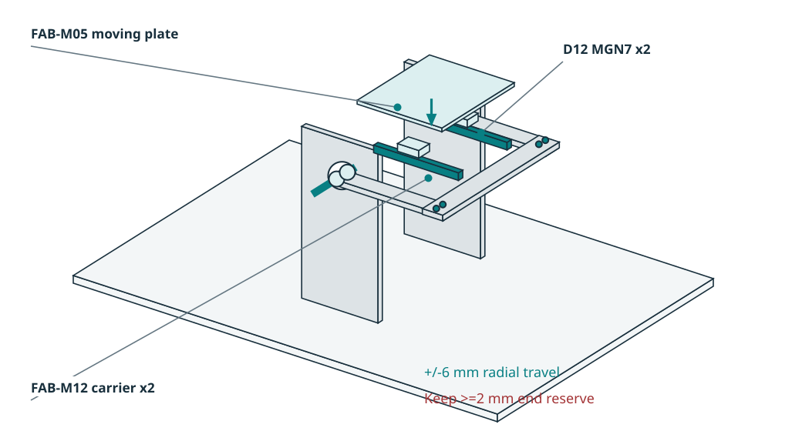

**Parts:** BOM D12 MGN7 rails/carriages x2; FAB-M12 carriers x2; FAB-M05 moving plate x1; vendor rail screws; F02 M4 plate hardware.

**Tools:** Straightedge, caliper, hex keys

1. Fit the two guide carriers across the yoke. Orient both 100 mm rails radially, toward/away from the hinge in the moving half's plane. Use the delivered rail hole pattern and prescribed screws, not assumed M4 rail screws.
2. Mount one rail as the reference; leave the second slightly loose. Attach the plate to both carriages through its adjustment slots. Move the plate gently and tighten the second rail without introducing a tight spot.
3. Center the available float and fit positive end retention so no carriage can leave its rail. Use released retainers; screws in a rail hole are acceptable only if they cannot strike rolling elements or violate the rail instructions.
4. Check at least +/-6 mm of usable radial float. During the eventual phone sweep, preserve at least 2 mm travel reserve at each end; revise the mount if the hinge consumes that reserve.

**Check:** Plate moves freely by hand, without appreciable preload, binding or loose carriage retention. H2 carrier and retention drawing is released.

Measured radial stroke: ______   Rail fixing torque/source: ______

## 08. Install the fixed cradle

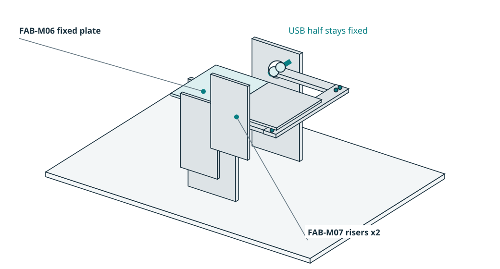

**Parts:** FAB-M06 fixed plate x1; FAB-M07 risers/feet x2; F02/F03 hardware; F04 shims; BOM T05 dummy.

**Tools:** Caliper, straightedge, angle gauge, shims

1. Attach the two risers on the negative-X side of the hinge. Loosely mount the fixed plate using its four 4.5 x 20 mm slots. The USB-port half is stationary.
2. Use the dummy and measured back-surface offsets to shim the fixed backing plane relative to the moving cradle at the open position. Z=140 mm is the hinge-axis datum, not automatically the top of either pad.
3. Machine camera, button and connector relief from the actual measurements. Keep support on rigid exterior frame/back lands. Do not copy one phone half's relief onto the other.
4. Manually sweep the empty/dummy mechanism. Check the fixed plate and risers against the rotating yoke, moving plate and screw ends throughout the arc, then tighten and mark.

**Check:** No interference at any angle; the plates do not force either leaf out of its natural plane. USB plug/strain relief space remains available.

Backing-plane offsets: ______   Minimum observed clearance: ______

## 09. Fit compliant shoes and pads

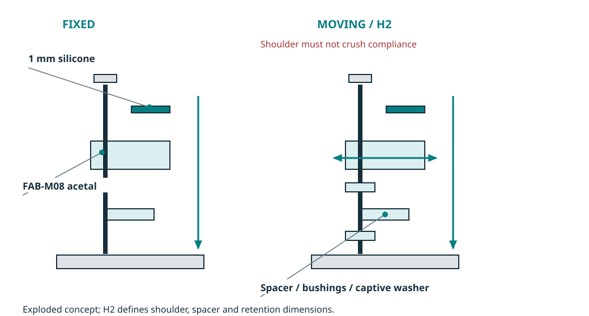

**Parts:** FAB-M08 acetal shoes x8 (BOM M03); BOM M04 1 mm silicone pad sheet; BOM M05 four shoulder screws, spacers, eight bushings and retainers.

**Tools:** Caliper, knife, hex keys, force gauge

1. Machine four shoe contact contours for each half from the actual frame map. Add 1 mm silicone pads, Shore A 30-40. Keep all shoes away from screen, hinge gap, buttons, lens glass and connectors.
2. Fix four shoes to the stationary plate. At the moving plate, assemble each of the four compliant mounts with the released shoulder-screw/spacer/bushing stack. The shoulder/spacer carries tightening load; do not crush the bushings solid.
3. Set approximately +/-2 mm tangential compliance with positive capture. Spacer length, shoulder length and washer diameters are H2 release items. A conceptual exploded stack is shown; it is not a dimensioned production joint.
4. Fit the dummy; check a 10 N tangential retention pull without slip. Later repeat phone fit gently within approved contact forces. If retention requires screen loading or excessive clamp pressure, redesign the shoes.

**Check:** All eight pads secure; moving mounts float and remain captive. Clamp witness marks can be seen with the guard shut.

Shoe drawing rev: ______   Dummy retention result: ______

## 10. Set stops and endpoint switches

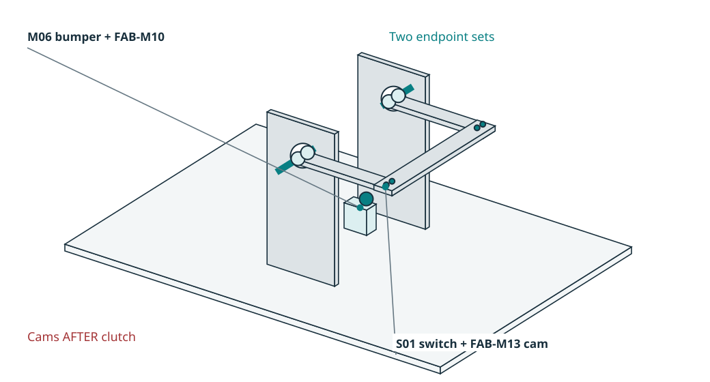

**Parts:** FAB-M10 brackets x4; BOM M06 bumper stops x2; S01 D2F-01L switches x2; FAB-M13 cams x2; F01/F02 mounting hardware.

**Tools:** Angle gauge, multimeter, hex keys

1. Fit one mechanical stop at each end of yoke travel. Both act on fixture structure, never on the phone. With a dummy, set an initial 5-175 degree operating span; place stops about 1 degree beyond endpoints only if that remains within safe free travel.
2. Mount switches independently of the stops. Use output-side cams on the yoke after the clutch; motor rotation alone must not prove that the phone moved.
3. Adjust each cam to actuate only close to its endpoint, leaving switch overtravel within its datasheet. The closed switch must release before the open switch can operate, and vice versa.
4. Lock all adjustments, add witness marks and measure physical stop/switch angles. Re-set for the real specimen before any full-range operation.

**Check:** Neither switch is a mechanical stop. Both cannot be active together. The yoke cannot drive the specimen into negative opening or overextension.

Closed switch/stop: ______   Open switch/stop: ______ degrees

## 11. Install and qualify the damper

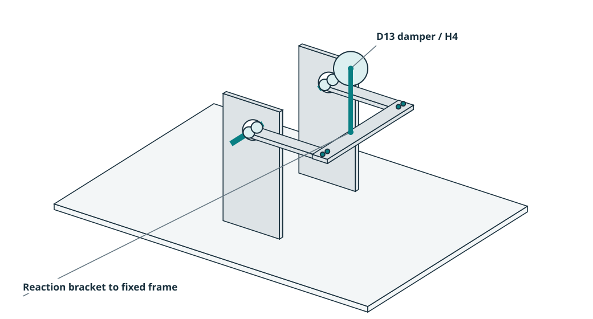

**Parts:** BOM D13 bidirectional damper; released H4 reaction bracket/coupling; dummy; fasteners specified on accepted damper drawing.

**Tools:** Force gauge, angle gauge, video/time reference

1. Select the damper from measured moving mass/inertia and expected gravity settling. The BOM contains an allowance, not a validated make/model or mounting pattern. Release H4 and procure its bracket/adapter before proceeding.
2. Attach the damper reaction member to a stationary support and its moving member to the yoke output side. Keep it clear of the phone and rails; confirm it resists both directions without becoming a hard stop.
3. With the motor mechanically uncoupled and a restrained dummy, release at several angles. Record gravity movement and time until stationary; keep hands outside the swept area.
4. Check added friction against the available clutch/current range. Excessive drag requires a different damper or counterbalance design, not a higher unqualified motor limit.

**Check:** Motion under power loss is measured. The damper is not credited as a safety-rated brake; guard access depends on the later stopping test.

Damper model/rev: ______   Worst settling angle/time: ______

## 12. Assemble the guard frame and panels

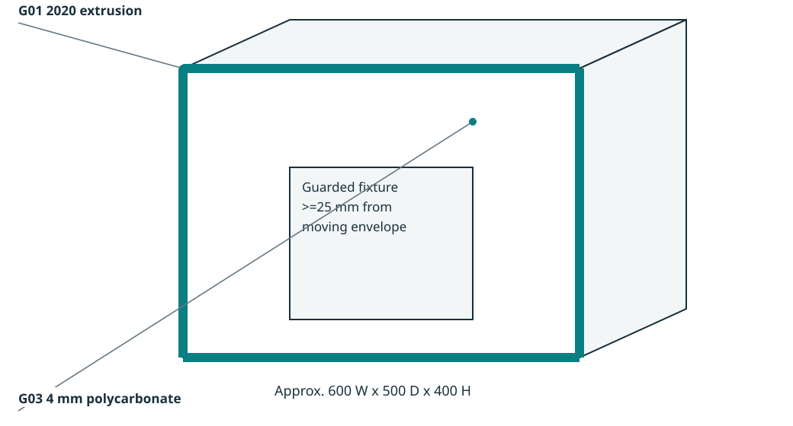

**Parts:** BOM G01 2020 frame; G02 brackets x24; G03 five 4 mm panels/FAB-M14; G04 clips/fasteners; released H3 supports.

**Tools:** Square, tape, hex keys, plastic drill/deburr tools

1. Dry-build the frame using matching slot-series parts. Stock schedule: four 560, four 460 and four 360 mm members. Confirm the chosen joint arrangement before cutting: these lengths alone do not define every overlap or final opening.
2. Mount the frame to the released support structure. Nominal external envelope is 600 x 500 x 400 mm. Sweep the complete mechanism by hand; maintain at least 25 mm to every moving item, including cable loops.
3. Fit rear, sides and top panels with captive clips and thermal-expansion clearance per the panel/fastener supplier. Nominal panels: 560 x 360 x2, 460 x 360 x2, 560 x 460 x1; trial-fit before final drilling.
4. Reserve the front panel for the door. Keep edges covered or rounded; assess all seams, ventilation slots and cable entries for reach-through.

**Check:** Frame square within 1 mm diagonal difference, securely supported; panels do not carry frame loads. 25 mm motion clearance is not a finger-access safety rating.

H3 drawing rev: ______   Smallest swept clearance: ______ mm

## 13. Hang the door and fit controls

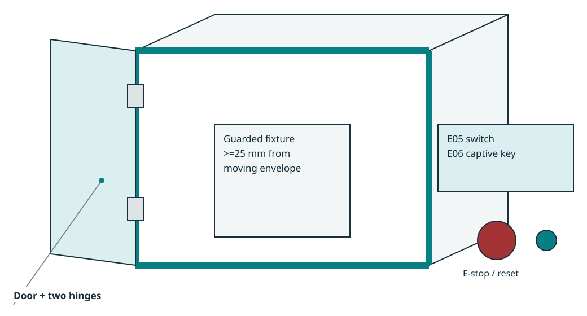

**Parts:** BOM G04 hinges x2, handle/latch; E05 D4NS-1BF; E06 D4DS-K2 key; E04 two-NC E-stop; E07 NO reset; mounting panel/brackets per H3.

**Tools:** Drill, hex keys, screwdriver, multimeter

1. Hang the front panel on two hinges. Install a positive door stop and latch; the switch body/key must not serve as the door's mechanical stop. Confirm smooth closing without bending the key.
2. Secure the tongue key captively to the door, and the switch to the fixed frame. Verify the delivered D4NS entry direction and operating stroke against its drawing. Use its specified gland and tightening values. [R4]
3. Mount the red/yellow E-stop and labeled physical reset outside the guard, reachable from the operator position with a clear view of the fixture. Record both E-stop NC contact labels before wiring.
4. With power absent, verify both guard NC paths open when the door opens and both E-stop NC paths open when pressed. Final access timing is tested in step 24.

**Check:** Closing the door or releasing the E-stop cannot start motion. If coast-down allows access to moving parts, a validated guard-locking redesign is required.

Switch/key alignment: ______   Contact IDs verified: ______

## 14. Mount the electrical enclosure

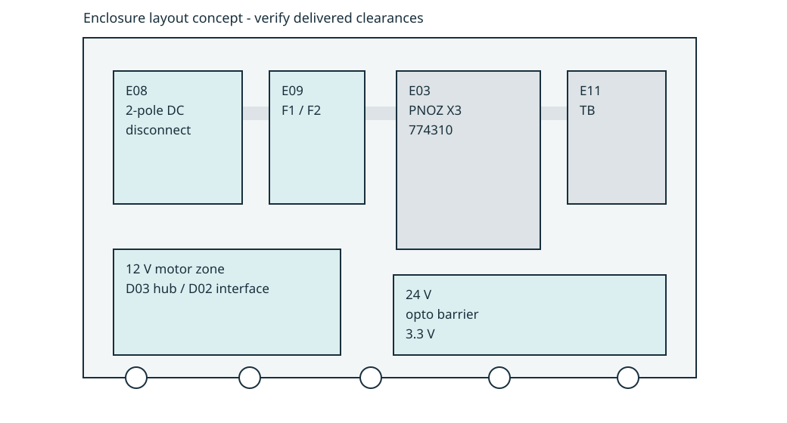

**Parts:** BOM E10 enclosure; E11 DIN/terminals; E03 PNOZ X3 774310; E08 DC disconnect; E09 F1/F2; W03 glands/ferrules; D02/D03 interface/hub.

**Tools:** Screwdriver, crimper, drill, label printer

1. Mount the nominal 300 x 250 x 150 mm covered enclosure outside the motion envelope. Arrange DIN rail, relay, fuse holders and labeled terminals with wiring space and access to every screw.
2. Define three labeled wiring zones: switched 12 V motor, 24 V safety, and 3.3 V Pi signal. Mount the optocoupler board on insulated standoffs with a physical gap between its 24 V and Pi sides.
3. Provide strain-relieved entries for two external SELV bricks, motor/USB, door/E-stop/reset, and sensors. Use external enclosed supplies; no exposed mains terminations are part of this design.
4. Mark the 2-pole disconnect as MOTOR + SAFETY DC ISOLATOR: one pole interrupts +12 V, the other +24 V. The separately powered Pi remains live; isolate all three supplies before internal service.

**Check:** Cover can close without crushing wires; service isolation is clear. All unused relay terminals insulated; no loose conductive debris.

Panel drawing rev: ______   Terminal/fuse labels checked: ______

## 15. Wire motor and relay power

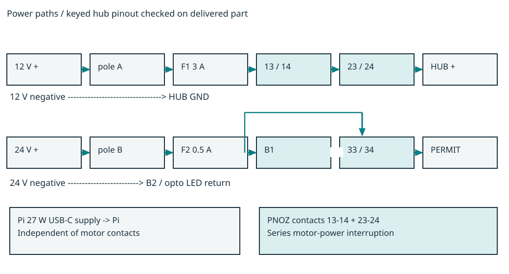

**Parts:** BOM E01 12 V/5 A, E02 24 V/1 A supplies; E08 disconnect; F1 3 A fast DC, F2 0.5 A DC; E03 relay; D03 hub; W01/W02 wire.

**Tools:** Crimper, insulated screwdriver, multimeter

1. With bricks unplugged, wire +12 V through disconnect pole A, F1 and relay terminal 13. Jumper 14 to 23; connect 24 to the hub + input. Connect 12 V negative directly to hub motor ground. Use 18 AWG for this branch.
2. Wire +24 V through disconnect pole B and F2 to relay B1. Wire 24 V negative to B2. B1/B2 are the DC supply terminals for this relay variant; do not substitute A1/A2. [R1]
3. Branch fused +24 V to relay 33. Relay 34 feeds the isolated permit board in step 17. The two series motor contacts remove +12 V; status contact 33-34 only reports relay state.
4. Keep the servo unplugged. Verify connector pin numbers/polarity at the delivered hub and confirm there is no alternate unswitched supply path. Record actual fuse part numbers and check contact/load/inrush coordination.

**Check:** Positive motor supply passes through both 13-14 and 23-24. No 24 V conductor reaches the Pi or motor positive input.

F1/F2 part numbers: ______   Continuity/polarity initials: ______

## 16. Wire the two safety channels

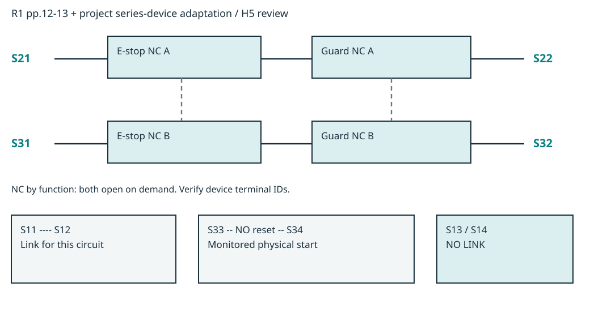

**Parts:** BOM E03 PNOZ X3; E04 E-stop contacts A/B; E05 guard NC contacts A/B; E07 NO reset; W02 22 AWG safety wire.

**Tools:** Multimeter, ferrule crimper, insulated screwdriver

1. Use the two-channel cross-short-detection input arrangement in Pilz 20547-EN-10 page 12, with the monitored-start arrangement on page 13. Retain the S11-S12 link for this selected circuit. Verify against the delivered relay revision. [R1]
2. Channel A: S21 -> E-stop NC-A -> guard NC-A -> S22. Channel B: S31 -> E-stop NC-B -> guard NC-B -> S32. Keep the channels separately labeled; verify actual switch contact markings with the meter.
3. Wire the momentary NO reset between S33 and S34. Leave S13/S14 unlinked. Do not apply external 24 V to these input terminals or substitute an API reset for the physical pushbutton.
4. Record this as a project adaptation using series-connected safeguards, not a certified whole-machine circuit. Have the electrical reviewer assess fault masking, short detection and reset behavior; test each device and channel separately.

**Check:** Both devices interrupt both channels. No automatic-start link. H5 electrical review and a point-to-point check are complete before step 21.

Relay manual revision: ______   Electrical reviewer: ______

## 17. Build the isolated permit input

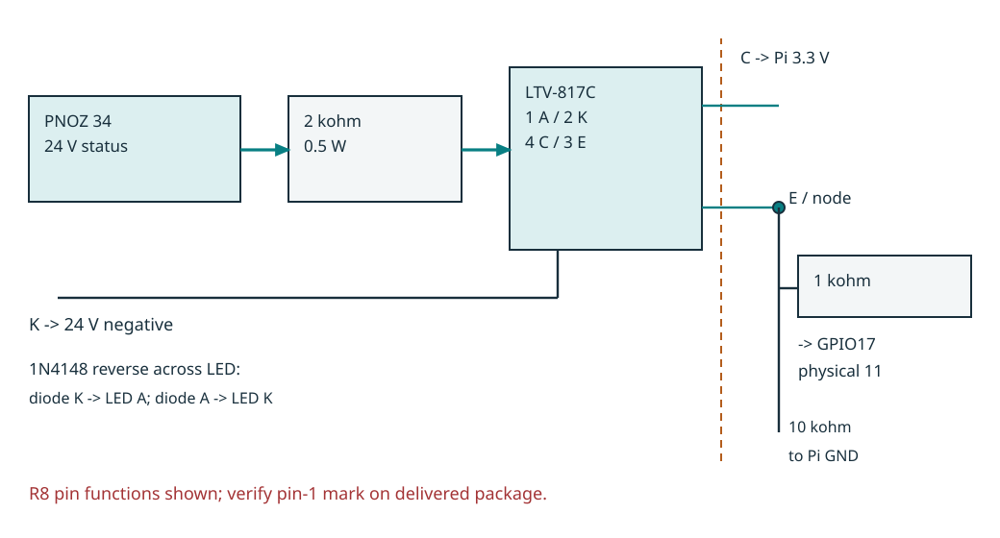

**Parts:** BOM S03: LTV-817C; 2 kohm 0.5 W; 1N4148; one 10 kohm and one 1 kohm; insulated board/terminals; W04 breakout.

**Tools:** Soldering tools, magnifier, multimeter

1. On the 24 V side, connect relay 34 through the 2 kohm resistor to LED anode; LED cathode returns to 24 V negative. Put the 1N4148 across the LED in reverse: diode cathode at LED anode, diode anode at LED cathode.
2. On the Pi side, connect phototransistor collector to 3.3 V. Connect emitter to the PERMIT node, 10 kohm from node to Pi ground, then 1 kohm from node to GPIO17 (physical pin 11).
3. For the LTV-817 four-pin package, the manufacturer identifies 1=anode, 2=cathode, 3=emitter and 4=collector. Locate the pin-1 mark and verify the actual package drawing before soldering; do not mirror the bottom view. Attach the checked pin map to H5. [R8]
4. Keep the two domains separated without a ground jumper. At 24 V the LED current is approximately 11 mA and resistor loss about 0.26 W. Confirm the actual resistor rating, CTR and temperature before closing the board cover.

**Check:** With the Pi signal pin disconnected, powered node is >2.0 V and <=3.3 V when permitted, <0.8 V when off. No 24 V path to the Pi side.

Optocoupler pin map/rev: ______   Node high/low: ______ V

## 18. Wire endpoints and temperature probes

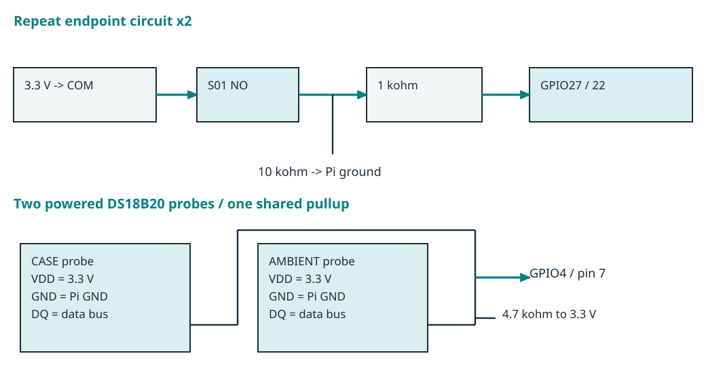

**Parts:** BOM S01 switches x2; S02 DS18B20 probes x2; remaining S03 resistors: 2 x 10 kohm, 2 x 1 kohm, 1 x 4.7 kohm; S04 attachments; W04 breakout.

**Tools:** Multimeter, screwdriver, labels, thermal tape

1. For each endpoint, connect switch COM to Pi 3.3 V and NO to its signal node; add 10 kohm node-to-ground and 1 kohm node-to-GPIO. OPEN uses GPIO27/pin 13; CLOSED uses GPIO22/pin 15. Insulate unused NC contacts.
2. Power both DS18B20 probes from 3.3 V and Pi ground. Join both data wires to GPIO4/pin 7 and use one shared 4.7 kohm pullup to 3.3 V. Use powered three-wire mode. Identify probe wire functions from its supplier, not cable color. [R5]
3. Attach the case probe to the stationary exterior frame/back with removable thermal tape. Place the ambient probe nearby in shaded free air. Keep both clear of the hinge, lens, flexible display and moving clamp.
4. Label both probe serials after software identification. Confirm wiring includes a service loop and fixed strain relief without a loop entering the swept envelope.

**Check:** Broken endpoint wire reads low. Each switch is high only at its own endpoint. Case probe stays attached throughout a manual sweep.

Case serial: ______   Ambient serial: ______   Wiring checked: ______

## 19. Install the Pi and finish the harness

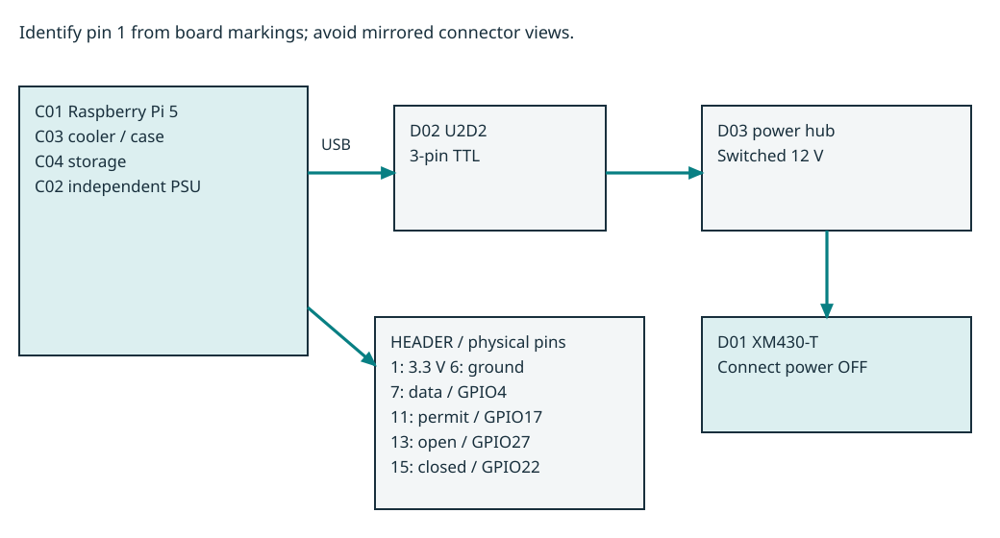

**Parts:** BOM C01-C05 Pi/cooler/card/supply/network; D02 U2D2, D03 hub, D05 USB, D06 TTL cables x2; W03 strain relief; W04 breakout.

**Tools:** Screwdriver, multimeter, cable labels

1. Install the active cooler and storage, then secure the Pi case outside the motion envelope with ventilation clear. Feed it only from its independent official USB-C supply.
2. With all power off, connect the keyed breakout and verify physical pin 1 orientation against the Pi board. Used pins: 1=3.3 V, 6=ground, 7=GPIO4, 11=GPIO17, 13=GPIO27, 15=GPIO22. Do not use 5 V pins for these circuits. [R6]
3. Connect Pi USB to U2D2, and its 3-pin TTL port to the power hub and XM430-T cable path. U2D2 does not power the motor; verify the keyed cable mapping and leave the motor end disconnected for now. [R3]
4. Bundle motor, safety and signal wiring separately. Label both ends; clamp the fixed side of every service loop. Keep cables away from collar screws, clutch, rail ends and stop bumpers.

**Check:** No connector can be pulled into motion. Pi remains powered independently of the motor contacts. Do not hot-plug DYNAMIXEL cables. [R3]

Header orientation checked: ______   USB/TTL continuity: ______

## 20. Inspect with every supply isolated

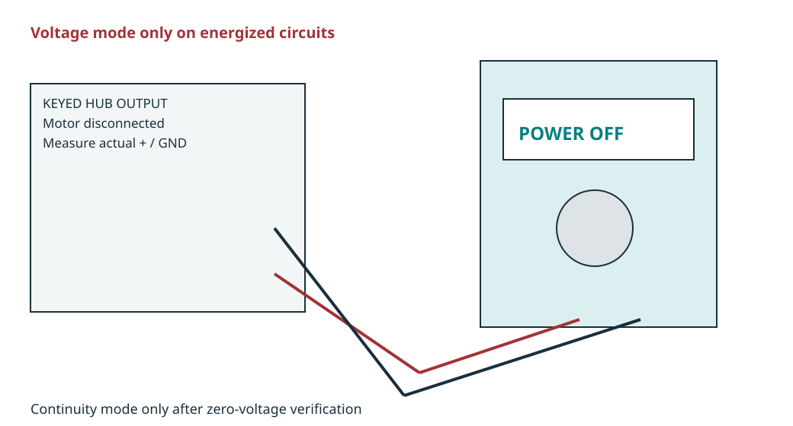

**Parts:** Assembled bench; BOM T03 meter; wire schedule and released H1-H5 drawings.

**Tools:** Multimeter, torque tool, inspection light

1. Unplug 12 V, 24 V and Pi supplies. Verify zero voltage before using continuity mode. Keep servo and Pi GPIO connector disconnected while checking the harness.
2. Check each wire against the wire schedule, including contact pairs, fuses, disconnect poles, negative returns and signal series resistors. Inspect ferrules for loose strands and tug each termination gently.
3. Verify there is no intentional connection between the isolated 24 V circuit and Pi signal ground. Account for any ground connection through USB on the 12 V motor side; do not infer whole-system galvanic isolation.
4. Inspect every fastener, collar, pad, cover and cable gland. Record measured fastener engagement/torque from approved sources. Close the electrical enclosure before energizing.

**Check:** Signed point-to-point inspection; no direct 12/24 V path to a Pi GPIO. All H1-H5 release items closed for the build phase being tested.

Electrical inspector/date: ______   Mechanical inspector/date: ______

## 21. Prove power removal with no motor

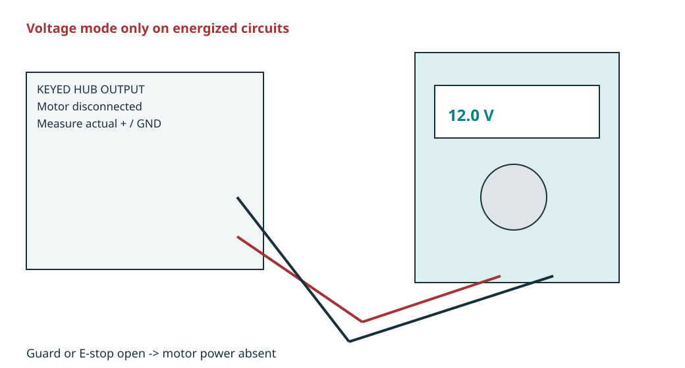

**Parts:** Servo disconnected; closed enclosure; meter at keyed motor-hub output; completed safety circuits.

**Tools:** Multimeter, test record, second observer

1. Apply power to the supplies with the servo unplugged. Verify relay supply polarity and voltage. With an open guard or pressed E-stop, motor-hub voltage must be near zero and permit low; investigate residual or alternate feed paths.
2. Close guard and release E-stop: motor supply must remain off until a valid physical reset. Reset should restore nominal 12 V at the hub and a valid permit level; it must not issue a motion command.
3. Operate E-stop and guard independently, then test each input channel by the approved electrical procedure. Verify motor voltage disappears. Check held-reset and power-restoration behavior; neither may bypass the intended monitored reset.
4. Isolate all supplies after testing. Only then connect the Pi signal harness and motor cable. Keep the drive mechanically uncoupled and the phone absent.

**Check:** All rows of the static power-removal record pass. Failure means stop and correct wiring; a software status bit is not proof of disconnected motor power.

Hub enabled/off voltage: ______   Reset/E-stop/guard results: ______

## 22. Install and verify the controller

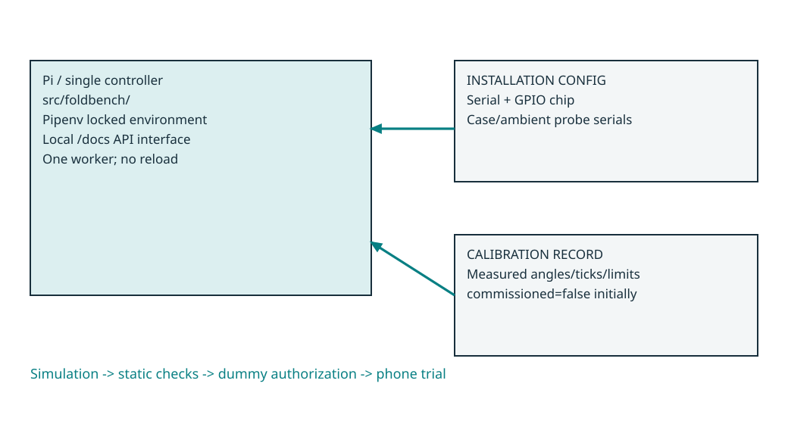

**Parts:** BOM SW01 source repository; Pi OS 64-bit; Python 3.12; Pipenv; deploy/ service and environment examples.

**Tools:** Network terminal, repository README, commissioning log

1. Install the repository at /opt/foldbench and create its in-project virtual environment with Pipenv. Use the locked dependencies. First run simulation and confirm /health, authenticated /v1/status and the interactive /docs page.
2. Create a dedicated foldbench service account with dialout/gpio access and /var/lib/foldbench ownership. Configure the supplied single-worker systemd unit. Keep it stopped during probe/index work; do not run a second controller.
3. Set a random API key, persistent serial path, real GPIO chip path, data path and calibration path in the protected environment file. Enable the w1-gpio overlay for BCM4 using the OS instructions; reboot and identify both probe serials by warming one gently.
4. Check header-chip identity and Linux GPIO v1 ABI availability. Start with commissioned=false; use hardware mode only after verifying settings. Observe each input/probe; an unsupported kernel or missing probe is a stop condition, not permission to bypass a check.

**Check:** Simulation API works; serial/GPIO/probe identities are recorded. Hardware remains unable to command runs with the example uncommissioned calibration.

Git commit/OS/kernel: ______   Serial path/GPIO chip: ______

## 23. Index the uncoupled motor and align ticks

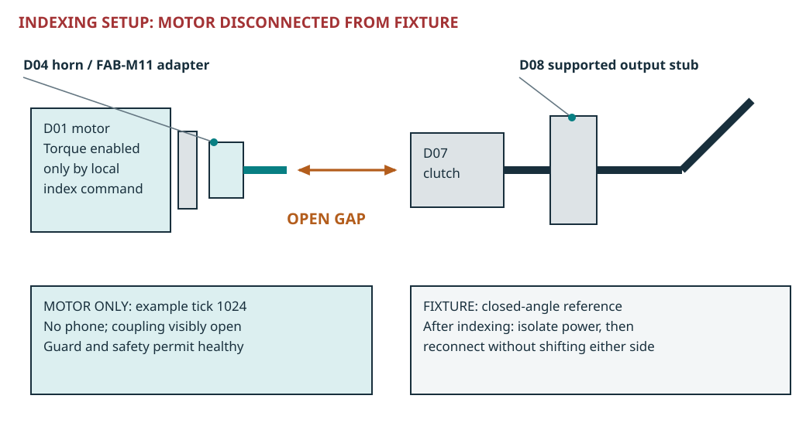

**Parts:** Uncoupled XM430-W350-T; empty fixture; probe utility; angle gauge; clutch connection still open.

**Tools:** Terminal, angle gauge, witness marks

1. Stop the service. Confirm the phone is absent and the motor is mechanically disconnected from the fixture. With guard/permit healthy, run the read-only probe and verify model 1020, firmware >=38, ID 1 and 57600 baud. Use vendor recovery for other ID/baud settings. [R2]
2. Only in that uncoupled condition, use the local probe indexing option shown in the software appendix to select a closed tick (example 1024). The command briefly enables low-current motion; --uncoupled is your declaration, not a coupling sensor.
3. Disable/isolate drive power, set the yoke at the measured closed endpoint, and reconnect the clutch without moving either side. Record closed angle/tick and provisional open tick = closed tick + angle span x 4096/360.
4. Verify positive ticks open the mechanism. For 5-175 degrees, 1024/2958 is only a starting example. Keep both ticks in 256-3839, their difference in 1500-2100 and angular agreement within 2 degrees as required by this software.

**Check:** No coupled indexing command used. Independent angle measurements and switches agree with the recorded stroke; direction is correct before cycling.

Closed angle/tick: ______   Open angle/tick: ______

## 24. Qualify empty and dummy motion

**Parts:** Empty fixture, then BOM T05 dummy; completed guard; qualified clutch/damper; temporary EMPTY-FIXTURE calibration record.

**Tools:** Angle/force gauges, independent tally/video, log

1. After static checks, create a signed dummy-only calibration with 5 degrees/s and the lowest current that moves the empty fixture within the installation ceiling. Only that supervised test record may set commissioned=true; it is not a phone release.
2. With guard closed, perform one endpoint jog at a time. Check direction, switch arrival and physical clearance. Operate E-stop and guard during motion; measure worst stopping/settling time and distance, then prove access is prevented until motion stops.
3. Test USB disconnection, Pi process/power loss, each endpoint/probe disconnection and a gentle instrumented dummy jam. Require faults, no false cycle increments and no automatic resumption. A watchdog fault requires inspection and motor power cycling.
4. Complete 100 dummy cycles, inspect, then 1,000. Record temperatures, cable wear, rail condition, witness marks, count agreement and clutch repeatability. Stop on any drift or wear.

**Check:** All fault injections and dummy runs recorded. If guard access precedes motion cessation, redesign guarding/locking before real-phone trials.

Dummy record ID: ______   Worst stop time/distance: ______

## 25. Fit the phone and measure protection

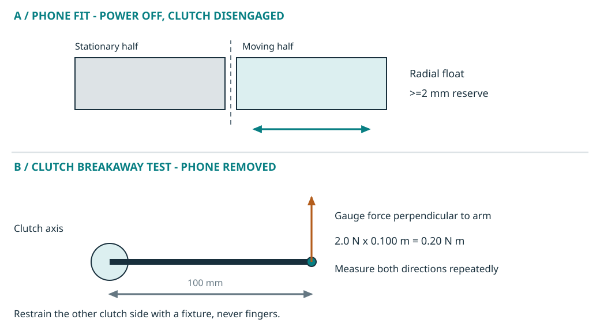

**Parts:** Actual phone; qualified shoes; BOM T02 force gauge/100 mm arm; thermal probe; clutch adjustment tools.

**Tools:** Force gauge, angle gauge, caliper, camera

1. With power isolated and clutch disengaged, install the stationary USB half first, then the moving half. Support both halves while fitting shoes. Hand-sweep through the intended range; verify no display contact, cable tug, clamp shift or forced hinge path.
2. Record radial carriage position and tangential float at 0, 45, 90, 135 and 180 degrees only where freely reachable. Preserve >=2 mm radial end reserve. Record actual safe endpoint angles rather than forcing mathematical 0/180.
3. Measure phone hinge load and empty-fixture gravity/friction separately. With the phone removed, set the clutch using the restrained fixture and calibrated 100 mm arm: torque = force x 0.100 m. Start near 0.20 N m only if compatible with measured loads; never exceed the 0.50 N m design ceiling.
4. Repeat breakaway measurements in both directions, initially targeting +/-10% repeatability. Lock/mark adjustment. Select the minimum successful current with measured protective margin; current is not a torque calibration. If limits are inadequate, revise the mechanics.

**Check:** Phone-specific fit and force record completed. Neither 0.20 N m nor 150 mA is presumed safe for every specimen.

Clutch CW/CCW torque: ______   Fit/load record: ______

## 26. Run the first phone trial and release

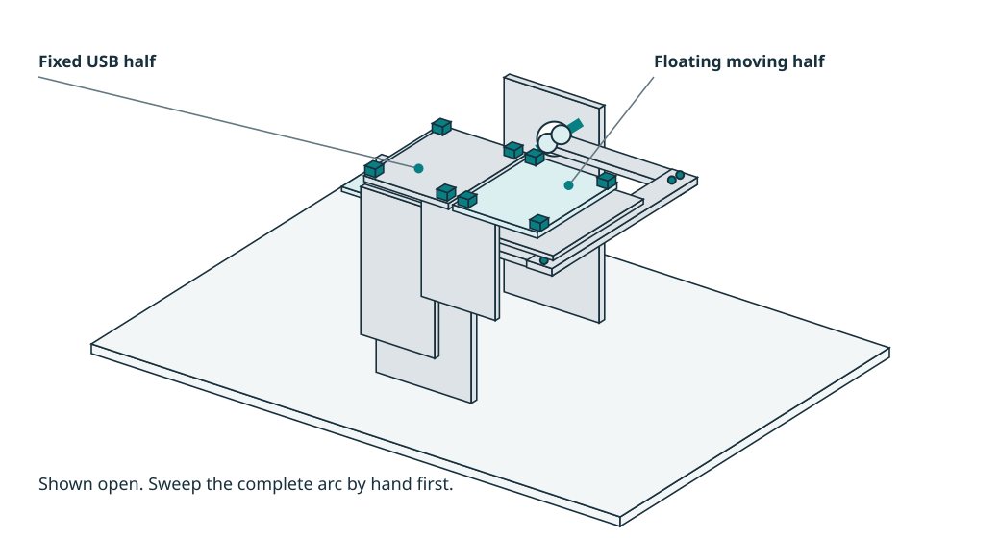

**Parts:** Phone-specific supervised-trial record; calibrated bench; API client; inspection log and baseline photographs.

**Tools:** Terminal, camera, touch/display test procedure

1. Archive the dummy calibration. Under a signed supervised-trial authorization, install a new phone-specific record with measured endpoints and limits. The software requires commissioned=true for motion; that flag is not evidence of routine-release approval.
2. Start one partial-fold cycle, normally 5-175 degrees, 5 degrees/s and 2-second endpoint dwells, using the measured current limit. Keep the guard closed and an operator at the E-stop. Inspect display, touch, frame, hinge, pads and cable after completion.
3. If acceptable, repeat ten cycles, inspect, then 100 and inspect. Record pass/fail through the API at pauses. Reconcile counted cycles independently; mechanical completion does not certify phone function.
4. Sign the final build record for supervised operation, with inspection intervals and remaining restrictions. Routine inspection starts at every 1,000 cycles. Any new shoes, stops, servo, firmware or safety wiring requires recommissioning; unattended service needs a separate release.

**Check:** Build records, as-built wiring, vendor drawings, software commit and backups delivered with the bench. Routine release is separate from temporary trial authorization.

Trial record: ______   Routine release/restrictions: ______

## Wire schedule

| IDs | From/path | To | Size |
| --- | --- | --- | --- |
| P12-01 | 12 V + | DC pole A input | 18 AWG |
| P12-02/03 | DC pole A output / F1 output | F1 input / relay 13 | 18 AWG |
| P12-04/05 | Relay 14 / relay 24 | Relay 23 / hub + | 18 AWG |
| P12-00 | 12 V negative | Hub GND | 18 AWG |
| P24-01/02 | 24 V + / DC pole B output | DC pole B input / F2 input | 22 AWG |
| P24-03/04 | F2 output | Relay B1 and 33 (branch) | 22 AWG |
| P24-00 | 24 V negative | Relay B2 / opto LED return | 22 AWG |
| SA-1/2/3 | S21 -> E-stop A -> guard A | S22 (series chain) | 22 AWG |
| SB-1/2/3 | S31 -> E-stop B -> guard B | S32 (separate series chain) | 22 AWG |
| SR-1/2 | S33 -> reset NO | S34 | 22 AWG |
| SL-1 | S11 | S12 link for selected R1 circuit | 22 AWG |
| ST-1/2 | Relay 34 -> 2 kohm -> LED A | LED K -> 24 V negative | 24-26 AWG |
| PI-01/06 | Pi pins 1 / 6 | 3.3 V / ground signal buses | 24-26 AWG |
| PI-11 | Permit emitter node via 1 kohm | GPIO17 / physical 11 | 24-26 AWG |
| PI-13/15 | Open / closed NO node via 1 kohm | GPIO27 / 22, physical 13 / 15 | 24-26 AWG |
| PI-07 | Both probe DQ; 4.7 kohm pullup | GPIO4 / physical 7 | 24-26 AWG |

## Manufacturer references

- R1: [Pilz PNOZ X3 20547-EN-10, pp.12-13; wiring authority](https://www.pilz.com/download/open/PNOZ_X3_Operating_Manual_20547-EN-10.pdf)
- R2: [ROBOTIS XM430-W350: model, modes, tick scale and watchdog](https://emanual.robotis.com/docs/en/dxl/x/xm430-w350/)
- R3: [ROBOTIS U2D2: TTL connection and external motor power](https://emanual.robotis.com/docs/en/parts/interface/u2d2/)
- R4: [OMRON D4NS: delivered switch/key mounting and contact data](https://www.ia.omron.com/data_pdf/cat/d4ns_d4ns-sk_ds_e_9_9_csm1235.pdf)
- R5: [Analog Devices DS18B20: powered 1-Wire connection](https://www.analog.com/media/en/technical-documentation/data-sheets/ds18b20.pdf)
- R6: [Raspberry Pi: physical GPIO header and 3.3 V interface](https://www.raspberrypi.com/documentation/computers/raspberry-pi.html#gpio)
- R7: [Dynatect Slip-Ease: EAS12 configuration; obtain accepted quote](https://www.dynatect.de/en/product/slip-ease-slip-clutches/)
- R8: [Lite-On LTV-817 family datasheet, package pin functions (manufacturer document hosted by Datasheets.com)](https://www.datasheets.com/lite-on/ltv-817s-b/datasheet.pdf)

The PDF also contains fastener-selection, software bring-up and static/dynamic acceptance worksheets.
